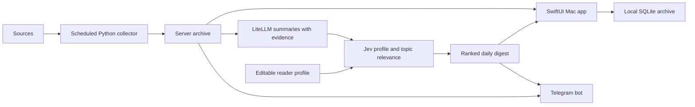

# News Feeder — design decisions

Recorded October 1, 2026. This document captures the agreed product direction and the initial implementation boundary.

## Product

News Feeder is a native macOS app for following AI models, APIs, agent tooling, and data platforms. A reader can browse a feed, read available article text inside the app, save stories, and review a custom daily digest. Every article and summary retains a source link. Downloaded content and reading state remain available offline.

Telegram is an additional delivery channel for the same feed and digests. It does not replace the native reader. The first integration supports explicit delivery from the app, scheduled daily digest delivery, and bot commands from the configured chat.

The default categories include OpenAI, Anthropic, LangChain/LangGraph, Databricks, MLflow, Y Combinator, and Hacker News. A category combines multiple independently configurable sources. Databricks includes its blog and four organization-level GitHub sources: `databricks-solutions`, `databricks-industry-solutions`, `databrickslabs`, and `databricks`. Repositories do not become separate sidebar or Settings entries. Organization feeds collect published releases and new public repositories; release notes and repository READMEs provide evidence for the existing summaries and Jev assessments. GitHub's public activity API provides up to 300 events within 30 days and can be delayed. All event pages are read without a timestamp cursor so delayed events are not skipped; a creation-sorted, paginated repository inventory also discovers new projects. This is a recent news feed, not an exhaustive commit or issue log.

The October 14 one-time upgrade replaces Databricks repository subscriptions with their parent organization sources. It adds organization membership to archived articles and soft-deletes the old subscriptions without changing article IDs or read/saved state. It leaves other categories, MLflow, and user profile/settings intact, and subsequent launches respect user configuration changes. MLflow remains a separate category with its official blog RSS and stable GitHub releases; automated model-catalog tags and prereleases are excluded by an editable release-tag pattern. Individual repository sources remain supported for other subscriptions.

Settings → Sources supports adding, renaming, and removing categories, and assigning sources to them. Defaults are editable, not hardcoded subscriptions. Sources can be added, edited, enabled, disabled, or removed without rebuilding. Removing a source preserves archived articles; removing a category leaves its sources uncategorized. Source settings include category, connector type, URL, topic filters, refresh interval, optional GitHub release-tag pattern, and website link selector/path pattern. The one-time category upgrade preserves existing source IDs, archived content, profile, credentials, and refresh settings; later launches respect user changes.

## Architecture

- Native client: Swift + SwiftUI, a three-column NavigationSplitView, native menus and keyboard shortcuts. Reading defaults to the macOS system font (SF Pro) at 18 pt, with system serif and rounded alternatives. Settings → Appearance and a toolbar reading control offer immediate font, 14–26 pt text size, and System/Light/Dark theme choices. The feed, TLDR, summary, source evidence, and full article share the chosen typeface and scale; controls remain native. Line spacing and a bounded reading column support longer text. Appearance choices persist locally on this Mac and work offline. Accent colors adapt to both themes, and selected feed rows use contrasting text. View menu shortcuts adjust reading size or restore 18 pt.
- Native storage: SQLite through GRDB. Article text, summaries, digest history, and read/saved state are cached locally. Sync merges server records without overwriting local reading state. Cache snapshots use deterministic JSON encoding and only write changed payloads, so repeated background polls do not rewrite unchanged articles and settings.
- Responsiveness (October 7): archive merging, decoding, persistence, date parsing, and feed indexing run in background tasks. A reusable index stores publication/relevance order, source membership, and normalized search text; section switches filter it without sorting or touching SQLite. Dates use value-type ISO 8601 parsing and are parsed once per item when building order. Sync publishes changed snapshots only; read/save updates are immediate and flags changed during sync are preserved. The previous 1,241-story archive load measured 9.3 seconds; the updated load measured 0.17–0.20 seconds with 1,381 stories. One hundred library filters measured 0.12 seconds in a debug build. These are local data-processing benchmarks, not end-to-end UI timings.
- Backend: Python, FastAPI, SQLAlchemy, and PostgreSQL in hosted deployments. SQLite is supported for local development and tests.
- Collection: a scheduled worker, RSS/Atom and source-specific website extraction, GitHub releases, and Hacker News's official API. Hosted workers collect independently of the Mac; installed local collection runs with the app or during an enabled background digest job. Individual source failures remain visible and do not stop other sources.
- LLM access: model calls use the T1A LiteLLM gateway. Summaries use `https://secondstack.t1a.io/gateway/api/v1/chat/completions`; Jev assessments use `https://secondstack.t1a.io/gateway/api/v1/systemone`. Load available summary models from `https://secondstack.t1a.io/gateway/api/v1/models` in Mac Settings → Models. A gateway virtual key is entered in a secure field and sent to the collection service; it is stored in the server database, scoped to its gateway URL, and never returned or synced. Model choices persist on the server and apply to new summaries. Environment key/model values are supported as defaults. Provider credentials and bot tokens stay on the server; the Mac keeps its backend access credential in Keychain.
- Deployment: containerized backend with a persistent database. No paid Apple Developer membership is required for local use. App Store publication and Developer ID/notarized distribution are later decisions.
- Local installation (October 28): a release ARM64 app is installed in Applications with a bundled, frozen Python service. Normal macOS launch owns the service lifecycle and requires no development checkout, Python installation, or shell launcher. The service binds only to loopback, exits with the app, and watches its parent to avoid orphaning after a crash. Existing remote/development connections remain supported. Mutable data, configuration, and logs live under `~/Library/Application Support/NewsFeeder`, outside the signed app. First installation imports the existing server and native archives using consistent SQLite backups, including WAL data; updates preserve installed data and back up the previous bundle. The native bundle identifier stays `app.newsfeeder.mac` so appearance preferences and Keychain account lookup remain compatible. Credentials/database files are never packaged into the bundle. No login item is added. This local build is ad-hoc signed; public distribution remains a separate decision.
- Installed startup retires a saved loopback demo address on port 8765 only when that connection is marked as demo. It then uses the imported live archive and bundled service on port 8000. Explicit environment overrides and custom/remote backend choices are preserved. SQLite import connections are closed and WAL contents checkpointed before atomically renaming the copied database.

## Content and evidence

Preserve extracted source text separately from generated summaries. Label content as full article, excerpt, or unavailable. Every story displays a TLDR in its list row and reader. A generated TLDR is one or two concise sentences, with source evidence retained alongside the rest of the summary. Pending or failed generation displays a labeled source excerpt; missing text displays a headline rather than invented analysis. A summary also contains what changed, why it matters, topics, practical impact, and citations with source passages. Validate cited passages against stored text. Schema validity is not proof of factual accuracy; attributed vendor claims stay attributed.

The initial implementation deduplicates canonical URLs and stores content hashes. A shared URL retains membership in each source that discovers it, so it appears in all relevant categories with one archived article and one set of reading flags. The original attribution and source link remain visible. Category assignments, release filters, and source memberships are cached for offline browsing. Category and membership metadata use additive tables so existing databases need no destructive migration. GitHub releases fall back to public Atom release notes on API rate-limit responses. Related-article clustering into one development is a later milestone; early UI shows articles rather than pretending clustering exists.

Summary generation uses a schema-constrained OpenAI-compatible endpoint through LiteLLM and validates the result with Pydantic. The endpoint and routed model must support the schema. Failure leaves the original article readable and exposes a summary status; no invented fallback analysis is presented. Cache by content hash and model alias to avoid repeat charges.

## Hype, importance, and relevance

These are separate dimensions:

1. **Hacker News buzz:** observed points, comments, age, and timestamped engagement snapshots. Growth is calculated only when multiple observations exist. No matching discussion means insufficient evidence, not low interest. This is a developer-community signal, not a claim about internet-wide attention.
2. **Practical impact:** an evidence-backed model assessment of capabilities, API changes, availability, pricing, and breaking changes. It is labeled as an assessment.
3. **Personal relevance:** Jev (`typesafe/jev-1.13`) assesses stories and each extracted topic against an editable reader profile in Settings → Profile. Source filters control collection separately. The profile is stored on the backend and cached on the Mac; the initial editable text reflects the requested AI model, API, LangChain/LangGraph, Databricks, OpenAI, Anthropic, and YC interests. It can be cleared or personalization disabled.

Jev uses a typed `score` question for the story and up to eight independent topic questions in one request. The five descriptive rubric levels are: outside interests, peripheral context, followed interest, direct priority/tool match, and an explicitly prioritized capability/API/release/decision. A returned 0–4 score becomes 0–100 by multiplying by 25. Feed rows and Telegram display three relevance tags instead of numeric scores: **High** for scores ≥75, **Medium** for scores ≥40 and <75, and **Low** for scores <40. The article reader displays TLDR, summary, source evidence, and article text without a relevance section. Numeric scores, topic assessments, and confidence stay internal for caching; confidence does not boost the ranking, and unknown assessments receive no relevance tag. This is a model estimate of relevance, not a probability of importance or a calibrated measure of accuracy. A story uses its available summary and up to 6,000 characters of source text; the assessment records when only a headline is available. The gateway receives the profile and this context. Jev does not generate a rationale, so no explanation is invented.

`For you` sorts by valid story relevance, then publication/discovery date. `Latest` sorts by date. Unscored stories remain visible below scored stories, distinctly from a score of zero. New digests and Telegram `/feed` use current relevance; digest keyword interests and practical impact break relevance ties. Existing digest membership stays reproducible. Failed or unconfigured assessments never become zero scores. Saving a profile immediately hides scores from the previous profile and starts a background refresh. Scores are cached in a separate additive table keyed by article, profile/model/rubric fingerprint, and evidence fingerprint. New summaries or changed text invalidate the evidence cache. Background work is bounded, failures isolated, and failures back off for 30 minutes; `Retry Missing Assessments` can retry sooner without recharging for unchanged successful scores. Stored request errors never include gateway response bodies or credentials.

Start with evidence and conservative buzz labels. Age-normalized percentile scoring requires a sufficient observation history and is deferred.

## Daily digests and Telegram

Digest preferences include topics, maximum story count, local delivery hour, and an IANA timezone (default America/Toronto). The October 29 channel integration refreshes sources before freezing one daily edition per local date/timezone. Its discovery window runs from the previous daily edition through preparation time, or the previous local day on first use, including articles discovered after the nominal delivery hour. Manual digests do not shorten this window. Membership and the time window are persisted for reproducibility. Delivery keys use the destination and local date, so restarts and schedule-hour changes cannot republish the same day's edition.

Telegram delivery is disabled by default. Settings → Digest & Telegram accepts a bot token and offers private-chat or channel delivery. For private delivery, the owner opens the bot, presses Start, and selects their discovered chat ID through Find My Chat; the bot's own username or numeric ID cannot be used as the destination. Channel delivery accepts a channel username/link or numeric ID and verifies channel type and administrator permission to post before storing the destination. Saving the bot verifies it without sending a message. Private channel IDs and private chats can be discovered from recent bot updates without acknowledging those updates. Tokens stay in the private service database and are redacted from validation errors and public configuration. Existing environment defaults and API configuration remain supported. Only the configured private chat can request `/feed`, `/digest`, and `/help`; channel mode does not poll commands.

Telegram news posts in both channels and private chats use bold headlines and section labels, italic source/priority metadata, restrained emojis, and explicit source links. TLDRs and why-it-matters sections have distinct paragraphs; High/Medium/Low priorities remain textual. Source excerpts and headline fallbacks are labeled. Formatting uses explicit entities with UTF-16 ranges, keeping source-provided HTML/Markdown literal and allowing only HTTP(S) citation links. Whole stories are packed together where they fit; oversized stories retain text and clipped formatting across numbered continuation messages. Text and entities are persisted together in the delivery's existing JSON messages, with backward compatibility for queued plain strings. No schema migration is required.

Messages are split conservatively within Telegram's UTF-16 limits and paced. An atomic persisted claim prevents concurrent send attempts. Receipts preserve destination, acknowledged message IDs, and chunk progress. Definite failures retry with backoff and rate-limit delays. Ambiguous sends remain blocked from automatic retry; the app requires the user to check Telegram before retrying unacknowledged chunks.

On the installed Mac, enabling verified daily delivery creates an opt-in user LaunchAgent that checks every 15 minutes and at login. It reuses the running app service through an instance-bound, narrowly scoped local runner credential, or holds an exclusive collector lock and starts a temporary service. Credentials are not written to the launch plist. The app can be closed, but the Mac must be awake and online. Wake/login catch-up publishes only the current day's edition. Disabling delivery removes the job. Hosted deployments continue using their running worker; always-on cloud delivery is not provided by the local installation.

## First implementation

- Runnable native reader and offline archive, source management, search, read/saved state, and digest screen.
- The default local launcher opens the actual feed and enabled sources. Detached mode gives it an independent process session, while quitting the app stops its local backend. A lock prevents duplicate launchers, and launcher/native/backend logs retain startup, termination signals, and exit information for diagnosis. Fictional fixtures are isolated and optional for development. Saved gateway settings can be retained when moving from the initial demo to the real feed.
- GitHub Trending is a configurable collector for the first 10 entries on the daily, all-language page. Its source view preserves GitHub order and latest-snapshot membership, including repositories already discovered by another source. Rank, primary language, daily star gains, total stars, and observation time are stored separately from article text and summary evidence in an additive repository metadata table; current membership lives in a persisted source snapshot. Previously observed repositories remain archived, including saved/read state. README text is cached on first discovery, with a labeled description fallback. Star updates do not invalidate summaries or Jev assessments. Failed fetches and changed markup retain the previous successful list and expose a source error. The page's ranking is GitHub's trending signal; it is not represented as a calibrated popularity score.
- Working configurable collectors, gateway summary adapter, collection status, persisted digests, and scheduling.
- Telegram feed/digest endpoints, owner-chat bot commands, message splitting, and delivery records.
- Explicit demo mode with fictional fixtures, isolated from live sources and disabled external messaging and summary generation. Gateway configuration and catalog reads remain available in Settings.
- Shiba Inu bringing a newspaper branding, preserving the original mascot and running pose. The transparent PNG is packaged as an ICNS with standard and Retina sizes and used by the native app and Dock.
- Tests for parsing/deduplication, persistence, citation validation, digest windows, auth, scheduling, Telegram delivery, and offline cache behavior where the toolchain supports them.

Not yet included: multiuser accounts, related-story clustering, semantic search, public notarized distribution and automatic updates, and calibrated industry-wide popularity scoring. No cloud deployment or external messaging takes place during implementation without configured credentials.

## References

- [SwiftUI NavigationSplitView](https://developer.apple.com/documentation/swiftui/navigationsplitview)
- [Apple system fonts](https://developer.apple.com/fonts/)
- [Apple accessibility guidance](https://developer.apple.com/design/human-interface-guidelines/accessibility)
- [GRDB](https://github.com/groue/GRDB.swift)
- [LiteLLM client setup](https://docs.litellm.ai/docs/proxy/client_setup/overview)
- [LiteLLM structured outputs](https://docs.litellm.ai/docs/completion/json_mode)
- [TypeSafe Jev Score primitive](https://docs.typesafe.ai/primitives/score)
- [TypeSafe confidence](https://docs.typesafe.ai/confidence)
- [OpenAI Structured Outputs](https://developers.openai.com/api/docs/guides/structured-outputs)
- [Hacker News API](https://github.com/HackerNews/API)
- [Telegram Bot API](https://core.telegram.org/bots/api)
